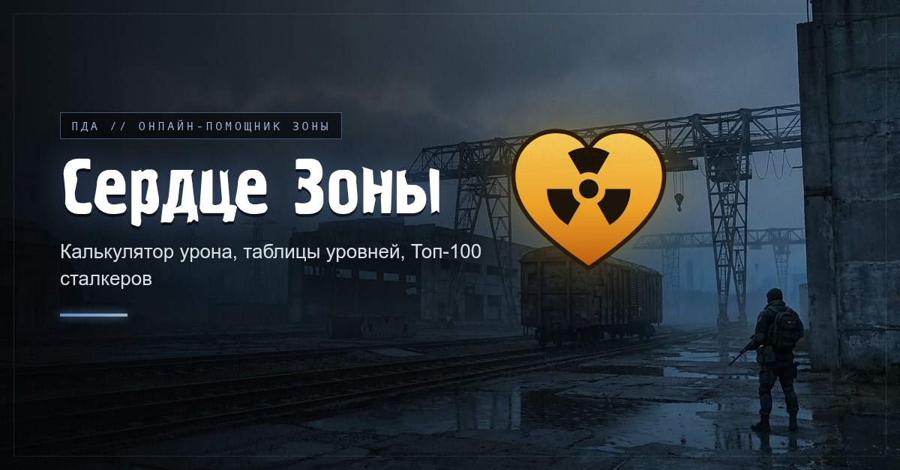

# Сердце Зоны - сайт-помощник

**Сайт: https://heart-of-the-zone.ru/**

Неофициальный сайт для игроков в «Сердце Зоны»: сделан игроком для игроков. Помогает посчитать урон, спланировать прокачку, найти себя в рейтинге и выбрать группировку.

## Главная

- Новости игры со ссылками на посты в группе ВКонтакте и новости самого сайта.
- **Моё место**: ваши места во всех рейтингах и как они изменились.
- Быстрый переход во все разделы.

## Калькулятор урона

- Урон каждого оружия с учётом уровня, снаряжения и талантов.
- **Снаряжение**: каждая вещь учитывается отдельно, включая новый комплект «Пятничный вечер».
- **Характеристики арены**: сумма вложенных очков даёт бонус к урону оружия.
- **Древо талантов**: распределяйте очки и сразу видьте, как меняется урон.
- **Расчёт по жетонам**: сколько урона дадут ваши жетоны и сколько их нужно на босса.
- **Мой арсенал**: впишите, сколько у вас гранат, гранатомётов и гауссов, и узнайте общий урон.
- **Мои билды**: несколько сохранённых сборок, переключение в один клик.
- Поделиться билдом одной ссылкой и сравнить свой билд с чужим.

## Информация

- Стоимость улучшения талантов и опыт для уровней персонажа и ПДА.
- **Задания**: награды на каждой локации и где выгоднее тратить энергию.
- **Боссы**: здоровье, требования и награды.

## Топ-100

- Лучшие игроки в семи рейтингах: репутация, боссы, тайники, таланты, коллекции, экспедиции и защита лагеря.
- Поиск по нику и по группировке, кто поднялся, опустился или попал в рейтинг впервые.
- **Личное дело**: карточка игрока со всеми его местами, ею можно поделиться ссылкой.
- **Это я**: отметьте себя, и ваша строка будет подсвечена во всех рейтингах.
- **Сравнение игроков**: два личных дела рядом.
- Рейтинг обновляется каждый день.

## Группировки

- Все группировки с лидером, уровнем, девизом и составом бойцов.
- Объявления о наборе, группы ВКонтакте и с кем связаться.
- Поиск по названию или нику и фильтр «Только с набором».

## Гайды

- Гайды пишут сами игроки: кнопка «Отправить свой гайд».
- Гайд появляется на сайте после проверки, с подписью автора.

## Удобство

- Удобно и на компьютере, и на телефоне.
- Десять оформлений в цветах группировок: Наёмники, Долг, Свобода, Учёные, Монолит, Рассвет, Вольные сталкеры, Торговцы, Ренегаты и Чистое небо.
- Живая главная: туман, пепел и вспышки аномалий на фоне.
- Новичков встречает ПДА сталкера и короткий тур по сайту.
- Сайт запоминает ваш билд и выбранное оформление.
- Сайт можно установить на телефон как приложение, и открытые раньше разделы будут работать без интернета.
- Сезонные праздничные украшения, например к Хэллоуину.

Техническое описание для разработчика - в [DEVELOPMENT.md](DEVELOPMENT.md).

by Sof
