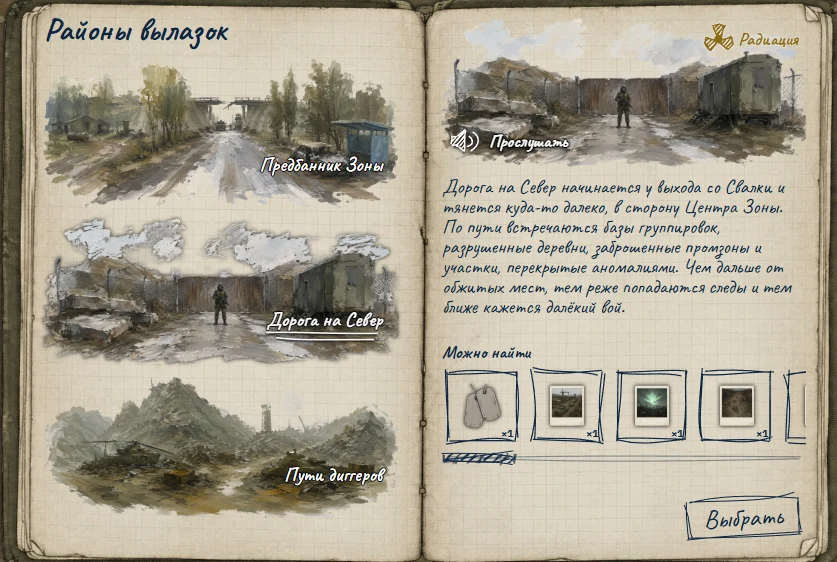
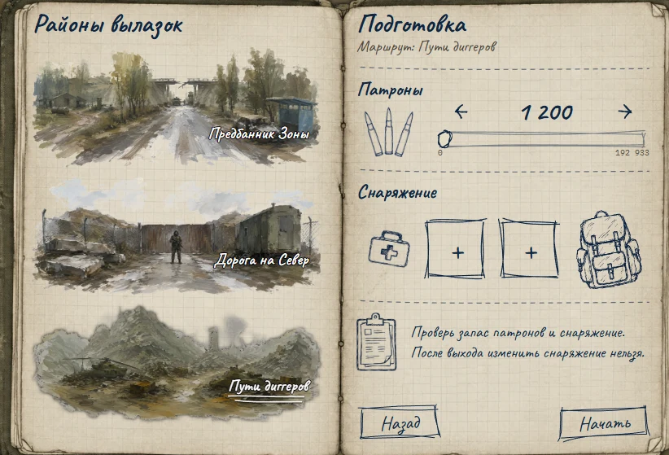
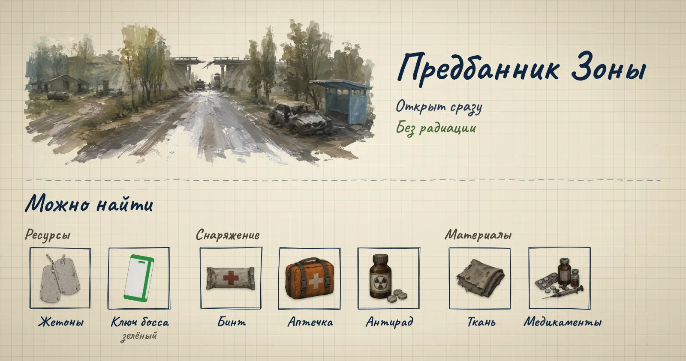
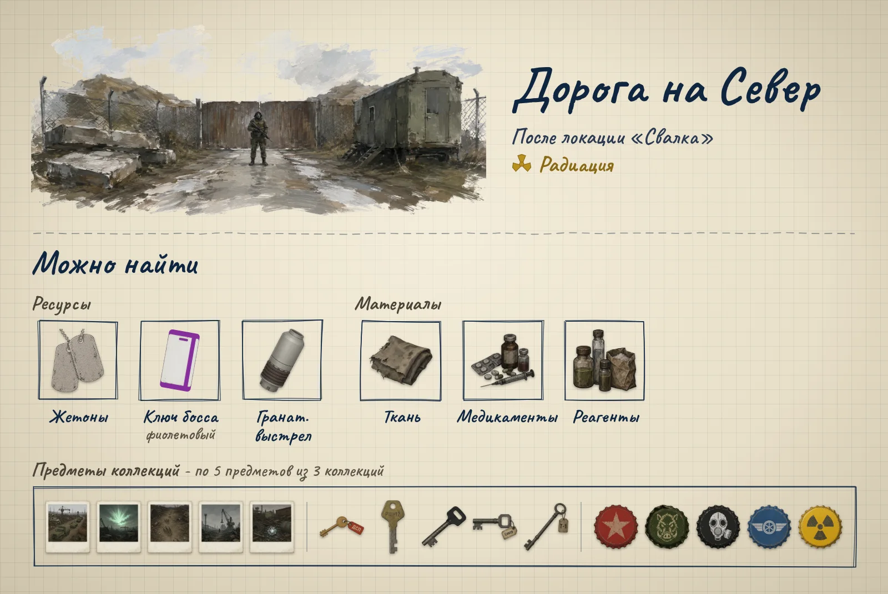
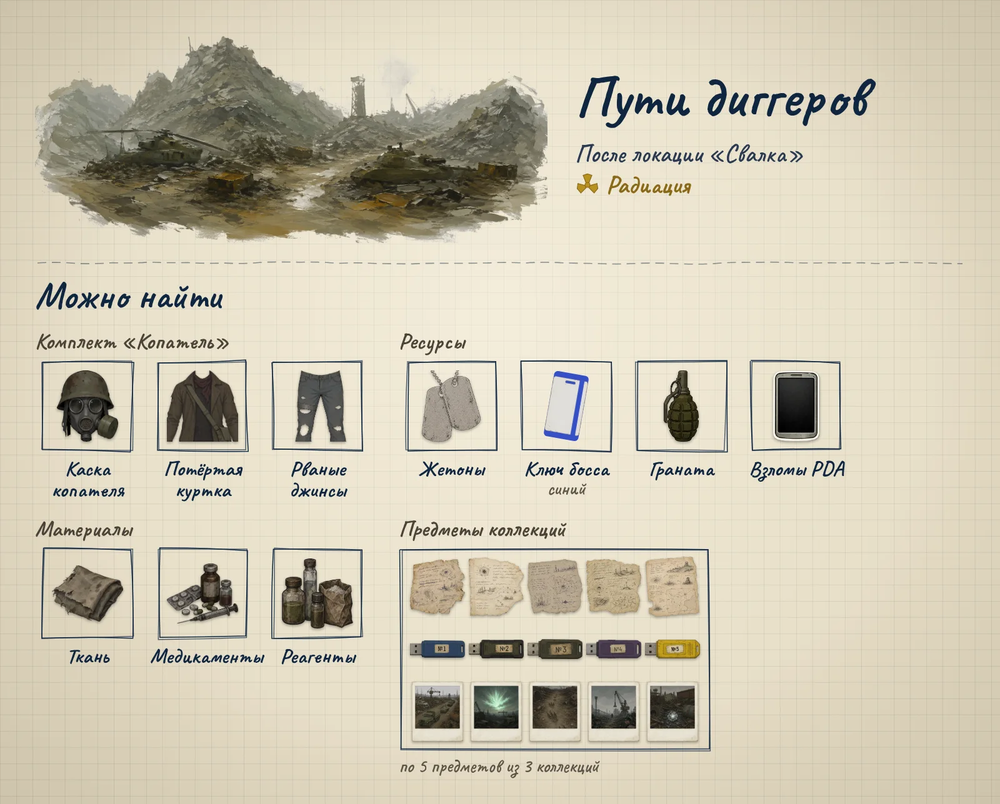
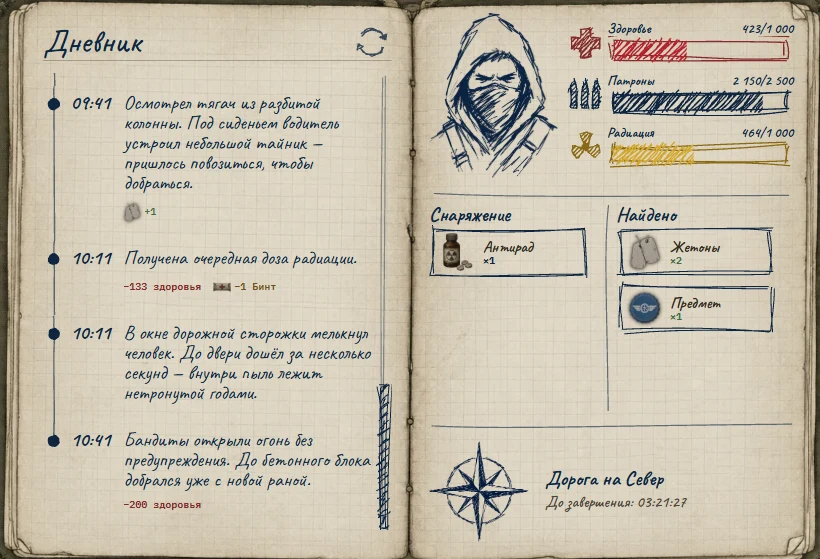

«Вылазки» - так теперь называются бывшие экспедиции. Ты выбираешь район, берёшь патроны и снаряжение и отправляешь сталкера в Зону на восемь часов. Дальше он действует сам: отстреливается, лечится, собирает находки и записывает всё в дневник. Тебе остаётся вернуться и забрать награду.

Цифры в гайде взяты из 126 дневников вылазок (Предбанник и Дорога на Север). По Путям диггеров статистика будет позже.

## Как отправиться на вылазку

1. Открой **Вылазки** в нижнем меню.
2. Выбери район. Справа появятся описание, отметка **Радиация** (если район радиоактивный) и список «Можно найти». Кнопка **Прослушать** включает озвучку описания.
3. Нажми **Выбрать** - откроется экран **Подготовка**.
4. Выставь патроны ползунком или стрелками. Игра сама подставляет рекомендуемое количество, но не больше, чем у тебя есть.
5. Заполни два слота снаряжения. В каждый слот кладётся один вид предмета в нужном количестве, а один и тот же предмет в оба слота положить нельзя.
6. Нажми **Начать**.

> После выхода изменить снаряжение нельзя, а вернуть сталкера досрочно тоже не получится. Всё проверяй до кнопки **Начать**.

Одновременно идёт только одна вылазка. Когда она закончится, появится «Вылазка завершена» и кнопка **Забрать награду** - пока не заберёшь, новую не начать. Неистраченные патроны и снаряжение возвращаются, так что брать с запасом не страшно. Вылазка длится 8 часов, значит за сутки можно успеть максимум три.

## Районы

### Предбанник Зоны

Южная окраина с заброшенными хуторами, железнодорожной насыпью и военными кордонами. Самый спокойный район: открыт сразу и без радиации.

- **Враги:** слепые псы, кабаны, бандиты, плоть, крысы, изредка солдат.
- **Можно найти:** жетоны, бинт, аптечку, антирад, ткань, медикаменты и **зелёный ключ босса** - он нужен для боя с Альфа-псом (подробнее на вкладке [«Боссы»](/info-bosses)).
- **За возвращение:** +60 опыта и +25 репутации.
- **В среднем за вылазку:** 2 жетона (от 0 до 5), 1,2 зелёного ключа (от 0 до 3) и 1,8 предмета. Три ключа на бой с Альфа-псом набираются примерно за 2-3 вылазки.

### Дорога на Север

Начинается у выхода со Свалки и тянется в сторону Центра Зоны. Открывается после прохождения локации «Свалка», в районе есть **радиация**.

- **Враги:** бандиты, кабаны, плоть, псевдособаки, слепые псы.
- **Можно найти:** жетоны, 15 предметов коллекций (фотографии, ключи и крышки - по 5 из трёх коллекций), гранатомётный выстрел, **фиолетовый ключ босса** (для Болотной твари), ткань, медикаменты и реагенты.
- **За возвращение:** +90 опыта, +1 жетон и +25 репутации.
- **В среднем за вылазку:** 4 жетона (от 2 до 6 вместе с жетоном за возвращение), 1,8 предмета, 0,6 гранатомётного выстрела и 0,3 фиолетового ключа.

### Пути диггеров

Маршруты через горы радиоактивного мусора и разбитой техники. Открывается после локации «Свалка», в районе тоже есть **радиация**.

- **Можно найти:** комплект «Копатель» (Каска копателя, Потёртая куртка, Рваные джинсы - редкий комплект), жетоны, предметы трёх коллекций (записки и карты, флешки, фотографии), **синий ключ босса** (для Борова), гранату, «Взломы PDA» (подробнее об этом читай в гайде [«Взлом ПДА»](/guide/vzlom-pda)), ткань, медикаменты и реагенты.
- Подробная статистика по этому району пока не собиралась, будет добавлена позже, так что готовься как к Дороге на Север.

## Как проходит вылазка

Каждые 30 минут в дневнике появляется запись: выход, 15 событий и возвращение. В радиоактивных районах к ним раз в час добавляется доза радиации. Под записью видно, что она дала или отняла: здоровье, патроны, снаряжение, находки. На правой странице - текущие здоровье, патроны и радиация, оставшееся снаряжение, найденное и время до конца вылазки. Кнопка в углу дневника обновляет записи.

Набор событий за вылазку в каждом районе всегда один и тот же - меняются только порядок и цифры.

**Предбанник Зоны:**

- 2 врага;
- 2 опасных события (аномалия, провал под ногами, колючка, зверь из кустов) - ровно 280 здоровья каждое;
- 1 потеря патронов (перестрелка без добычи или выпавший магазин) - 80-200 патронов;
- 3 тайника, примерно каждый третий пустой;
- 7 спокойных записей.

**Дорога на Север:**

- 3 врага;
- 1 опасное событие (засада, аномалия, арматура, мутант) - ровно 200 здоровья;
- 2 потери патронов - 120-270 патронов каждая;
- 2 тайника, примерно каждый пятый пустой;
- 7 спокойных записей и 8 доз радиации.

Про врагов:

- Встреча с врагом стоит патронов и здоровья: в Предбаннике 60-240 патронов и 50-125 здоровья, на Дороге на Север 60-340 патронов и 50-200 здоровья. Вид врага на это не влияет.
- За убитого врага часто дают награду.
- Примерно в каждой шестой встрече начинается кровотечение (о нём ниже).
- Если в бою кончились патроны, сталкер сбегает («Пришлось сбежать»): враг не убит, награды нет.

## Здоровье, бинты и аптечки

Запас здоровья - 1000. Лечение срабатывает само:

- **Бинт** - +200 здоровья и останавливает кровотечение. Сталкер перевязывается, когда здоровья 500 или меньше, и сразу, как только началось кровотечение.
- **Аптечка** - +500 здоровья, срабатывает при 500 здоровья и меньше. Кровотечение она **не останавливает**.
- Выше 1000 лечение здоровье не поднимает.

**Кровотечение** («Началось кровотечение») отнимает 50 здоровья каждые 30 минут до самого конца вылазки, пока его не остановит бинт. Если оно началось в первые часы, набегает до 700 здоровья - больше, чем любое опасное событие.

Если здоровье закончилось - эвакуация: «Вылазка провалена», весь найденный хабар теряется, а перед следующей вылазкой сталкеру нужно перевести дух (таймер «До следующего выхода»).

## Радиация

В Предбаннике радиации нет, на Дороге на Север и Путях диггеров - есть. Раз в час сталкер получает дозу, и каждая следующая на 10% сильнее: 100, 110, 121, 133, 146 и так далее. Доза сразу отнимает столько же здоровья и копится на шкале радиации.

Когда накопленная радиация доходит до 500, срабатывает **антирад** (если он есть в твоём снаряжении): шкала обнуляется, и сталкер получает обратно здоровье, которое забрала радиация. Это происходит на пятом тике (464 + 146 = 610). После этого дозы снова начинаются со 100 и до конца вылазки набирают ещё 331 - до второго антирада дело не доходит.

> Без антирада одна только радиация за вылазку отнимает 1142 здоровья - больше всего запаса. Один антирад в радиоактивный район обязателен, а более одного брать смысла нет.

## Патроны

Патроны уходят на врагов и теряются в перестрелках. Сколько тратилось за вылазку:

- **Предбанник Зоны:** в среднем 434, максимум 634. С таким набором событий больше 680 не потратить, так что **700 патронов** хватит всегда.
- **Дорога на Север:** в среднем 957, от 543 до 1245. Больше 1000 ушло в 28 вылазках из 76, а 1200 и больше - в 3. В худшем случае может уйти около 1560, поэтому бери **1600**, если есть.

Остаток вернётся, а нехватка патронов - это сбежавший враг и потерянная награда.

## Снаряжение: что брать

Слотов всего два, и в каждый - один вид предмета.

**Предбанник Зоны:**

- без снаряжения шанс завершить вылазку - ~80%;
- с одним бинтом или одной аптечкой шанс выжить - ~99%, обычно этого достаточно, но для уверенности можно взять 2 бинта/2 аптечки или 1 бинт и 1 аптечку.

**Дорога на Север:**

- с одним антирадом, без бинтов и аптечек шанс выжить - ~40%;
- с антирадом и 1 аптечкой шанс выжить - ~90%;
- с антирадом и 2 бинтами/2 аптечками шанс выжить - ~99%, обычно этого достаточно, но для уверенности можно добавить по 1 бинту/аптечке.

**Пути диггеров:** точная статистика пока не собиралась, готовься, как на Дорогу на Север.

Бинты выгоднее аптечек: они ещё и останавливают кровотечение, а в Мастерской в Лагере обходятся дешевле:

- **Бинт** - ткань ×2;
- **Аптечка** - ткань ×2 и медикаменты ×2;
- **Антирад** - медикаменты ×1 и реагенты ×2.

Ткань, медикаменты и реагенты сами попадаются в вылазках, так что расходники быстро окупаются.

## Куда ходить

- **Предбанник Зоны** - за зелёными ключами для Альфа-пса и материалами. Почти без риска и мало патронов.
- **Дорога на Север** - вдвое больше жетонов, предметы коллекций, гранатомётные выстрелы и фиолетовые ключи для Болотной твари. Стоит антирада, пары бинтов и около тысячи патронов.
- **Пути диггеров** - комплект «Копатель», синие ключи для Борова, гранаты и «Взломы PDA».

## Коротко

- Вылазка - это 8 часов и 15 событий, и набор событий в районе всегда одинаковый.
- Перед радиоактивным районом проверь, что есть антирад - без него расходов будет гораздо больше.
- Бинты лучше аптечек: они ещё и останавливают кровотечение.
- Патронов бери с запасом - остаток вернётся.
